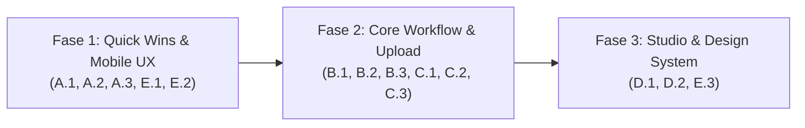

# Dokumen Rekomendasi & Deskripsi Pekerjaan Peningkatan UI/UX
**Produk:** Portal Praktik Poliwako (LMS Pembelajaran Praktik Vokasi)  
**Institusi:** Politeknik Sorowako  
**Tanggal Audit:** 14 November 2026  
**Status:** Rekomendasi Desain & Arsitektur Antarmuka (Tanpa Perubahan Kode)

---

## 1. Ringkasan Eksekutif

Secara fondasi fungsional, **Portal Praktik Poliwako** telah memiliki arsitektur fitur yang kuat dan terarah sesuai kebutuhan pembelajaran berbasis *Outcome-Based Education* (OBE)—mulai dari pemisahan **Portal Mahasiswa** dan **Command Center Instruktur**, *progressive learning workspace*, *split-screen grading*, hingga dukungan *Dark Mode*.

Namun, berdasarkan audit kode antarmuka (*frontend audit*), masih terdapat peluang peningkatan signifikan pada:
1. **Ergonomi Penggunaan (*Usability*) & Navigasi:** Mengurangi duplikasi menu dan mempermudah orientasi pengguna.
2. **Pengalaman Perangkat Mobile (*Mobile Ergonomics*):** Memastikan mahasiswa yang mengakses portal lewat smartphone di laboratorium/bengkel tetap nyaman membaca materi dan mengunggah tugas.
3. **Efisiensi Alur Kerja Instruktur (*Grading & Authoring Velocity*):** Mengurangi jumlah klik dan *scroll* saat memeriksa puluhan berkas laporan/CAD mahasiswa.
4. **Konsistensi Sistem Desain (*Design System & Accessibility*):** Menertibkan ukuran font mikro, *touch target*, serta token warna *Light/Dark Mode*.

---

## 2. Rincian Deskripsi Pekerjaan per Modul

### Modul A: Portal Mahasiswa & Learning Workspace
**File Terkait:**
- `src/components/student/StudentPortal.tsx`
- `src/components/student/StudentDashboard.tsx`
- `src/components/student/StudentCourseCatalog.tsx`
- `src/components/student/StudentGradeCard.tsx`

| Kode | Item Pekerjaan | Kondisi Saat Ini (*As-Is*) | Rekomendasi Peningkatan (*To-Be*) | Dampak UX |
| :--- | :--- | :--- | :--- | :--- |
| **A.1** | **Penyederhanaan Navigasi Ganda (*Dual Navigation*)** | Item *Final Project* dan *Nilai Akhir* tampil di dua tempat sekaligus: di bagian bawah sidebar *Course Outline* dan di *Top Tab Navigation* (`Beranda`, `Materi`, `Berkas Akhir`, `Nilai`). | Memisahkan peran navigasi secara tegas: *Top Tab* khusus untuk perpindahan konteks utama (`Beranda`, `Materi & Unit`, `Berkas Akhir`, `Nilai`), sedangkan *Course Outline* fokus 100% menampilkan daftar *Unit Pembelajaran* dan indikator progres tugas per unit. | Mengurangi kebingungan kognitif mahasiswa saat berpindah tab vs unit. |
| **A.2** | **Mobile Drawer / Bottom Sheet untuk Course Outline** | Pada layar `< 1024px`, *Course Outline* ditumpuk secara vertikal di atas konten utama saat dibuka, sehingga mendorong materi pembelajaran jauh ke bawah. | Mengubah *Course Outline* di layar mobile menjadi *slide-over drawer* atau *bottom sheet* dengan *backdrop* blur, dilengkapi *sticky bottom action bar* untuk tombol `Sebelumnya` dan `Selanjutnya`. | Menghemat ruang vertikal di layar smartphone hingga 45%. |
| **A.3** | **Penyelarasan Kartu Nilai Mahasiswa dengan PRD** | Pada `StudentGradeCard.tsx`, rincian skor mentah (`Kualitas 70%`, `Sikap 10%`, `Kreativitas 5%`, `Laporan 15%`) ditampilkan ke mahasiswa, berbeda dengan ketentuan PRD Seksi 60. | Menyederhanakan tampilan kartu nilai agar berfokus pada **Nilai Akhir**, **Predikat/Huruf Mutu**, **Catatan Feedback Instruktur**, serta ringkasan visual status kelulusan/remedial. | Tampilan lebih fokus, bersih, dan patuh pada spesifikasi PRD. |

---

### Modul B: Pengumpulan Tugas, Final Project & Remedial
**File Terkait:**
- `src/components/student/StudentAssignmentCard.tsx`
- `src/components/student/StudentFinalProjectCard.tsx`
- `src/components/student/StudentGradeCard.tsx`

| Kode | Item Pekerjaan | Kondisi Saat Ini (*As-Is*) | Rekomendasi Peningkatan (*To-Be*) | Dampak UX |
| :--- | :--- | :--- | :--- | :--- |
| **B.1** | **Unifikasi Komponen *File Upload Dropzone*** | `StudentAssignmentCard` sudah mendukung *drag-and-drop*, tetapi `StudentFinalProjectCard` dan unggahan Remedial di `StudentGradeCard` masih menggunakan gaya tombol/kotak input berbeda tanpa dukungan *drag-and-drop*. | Membuat komponen terpadu `UnifiedFileUploadDropzone` yang konsisten di seluruh tempat pengumpulan berkas (Tugas Unit, Final Project, Remedial) lengkap dengan validasi ekstensi & ukuran instan. | Konsistensi interaksi dan pengurangan duplikasi kode UI. |
| **B.2** | **Indikator Tahapan Unggah Berkas Besar** | Saat mengunggah file CAD/ZIP berukuran besar (hingga 50–100 MB), indikator hanya menampilkan *spinner* teks statis. | Menambahkan *step progress visual* (`1. Validasi Berkas` -> `2. Mengunggah ke Server/Drive` -> `3. Menyimpan Bukti`) agar mahasiswa mengetahui proses belum macet. | Menurunkan kecemasan mahasiswa saat mengunggah berkas berukuran besar di jaringan kampus. |
| **B.3** | **Pembaruan Kartu Bukti Pengumpulan (*Digital Receipt*)** | Bukti pengumpulan tugas diunduh sebagai file teks `.txt` polos. | Menyediakan tampilan modal/kartu *Digital Submission Receipt* berdesain resmi (mencantumkan Nama, NIM, Nama File, Ukuran, Waktu Server WITA, dan ID Bukti) yang siap dicetak/disimpan sebagai PDF atau gambar. | Meningkatkan kepercayaan dan kerapian dokumentasi pengumpulan tugas. |

---

### Modul C: OBE Grading Workspace (Sisi Instruktur)
**File Terkait:**
- `src/components/instructor/GradingWorkspace.tsx`

| Kode | Item Pekerjaan | Kondisi Saat Ini (*As-Is*) | Rekomendasi Peningkatan (*To-Be*) | Dampak UX |
| :--- | :--- | :--- | :--- | :--- |
| **C.1** | **Resizable Split-Pane (Pengaturan Proporsi Layar)** | Proporsi layar antara Panel Pratinjau Dokumen (Kiri) dan Panel Rubrik OBE (Kanan) terkunci pada rasio `50% : 50%` (`lg:col-span-6`). | Menambahkan kontrol proporsi cepat (`50:50`, `65:35 Fokus Gambar/PDF`, `35:65 Fokus Rubrik`) atau *split divider* fleksibel. | Instruktur lebih leluasa memeriksa detail gambar kerja CAD atau laporan panjang. |
| **C.2** | **Sticky Grading Summary & Action Bar** | Tombol simpan dan ringkasan nilai akhir berada di bagian bawah panel yang memerlukan *scroll* panjang ketika kriteria Sub-CPMK cukup banyak. | Membuat *Sticky Footer Bar* di dalam panel penilaian kanan yang selalu menampilkan **Skor Kualitas**, **Nilai Akhir OBE Real-Time**, indikator `✓ Tersimpan`, dan tombol `Simpan & Mahasiswa Berikutnya`. | Mempercepat alur penilaian per mahasiswa hingga 30–40%. |
| **C.3** | **Daftar Antrean Mahasiswa Interaktif (*Quick Queue Strip*)** | Perpindahan mahasiswa mengandalkan tombol *Previous/Next* atau *filter dropdown*, sehingga kurang terlihat peta keseluruhan mahasiswa mana yang sudah/belum dinilai. | Menambahkan *collapsible student queue strip/drawer* dengan lencana warna status (`Siap Dinilai`, `Revisi`, `Draft Nilai`, `Terpublikasi`) untuk berpindah ke mahasiswa mana pun dalam 1 klik. | Memudahkan instruktur memantau progres pemeriksaan satu gelombang praktik. |

---

### Modul D: Learning Content Studio (Authoring Modul & Tugas)
**File Terkait:**
- `src/components/instructor/LearningContentStudio.tsx`

| Kode | Item Pekerjaan | Kondisi Saat Ini (*As-Is*) | Rekomendasi Peningkatan (*To-Be*) | Dampak UX |
| :--- | :--- | :--- | :--- | :--- |
| **D.1** | **Mode Pratinjau Mahasiswa (*Preview as Student*)** | Instruktur menyusun *Rich Text*, video YouTube, kuis, dan tugas di studio, namun harus berpindah ke portal mahasiswa untuk melihat hasil tampilannya. | Menambahkan tombol **Pratinjau Tampilan Mahasiswa** langsung di dalam `LearningContentStudio` untuk merender unit aktif persis seperti yang dilihat mahasiswa. | Memangkas waktu pengecekan tampilan materi dan kuis oleh instruktur. |
| **D.2** | **Segmentasi Visual Konten di Dalam Unit** | Daftar lampiran materi, kuis, dan tugas berada dalam satu alur panjang dengan banyak dialog modal terpisah. | Mengelompokkan isi unit ke dalam 3 blok kartu yang jelas: `1. Materi & Video`, `2. Kuis Evaluasi`, dan `3. Tugas & Tenggat Pengumpulan`, dengan tombol pengurutan (*reorder*) yang lebih ergonomis. | Struktur modul lebih mudah dipindai dan dikelola instruktur. |

---

### Modul E: Sistem Desain Global, Responsivitas & Aksesibilitas
**File Terkait:**
- `src/index.css`
- `src/App.tsx`
- `src/components/portal/PortalSelectorGate.tsx`
- `src/components/student/StudentIdentityModal.tsx`

| Kode | Item Pekerjaan | Kondisi Saat Ini (*As-Is*) | Rekomendasi Peningkatan (*To-Be*) | Dampak UX |
| :--- | :--- | :--- | :--- | :--- |
| **E.1** | **Penghapusan `transform: scale()` Paksa pada Halaman Gate** | `PortalSelectorGate.tsx` menggunakan perhitungan `transform: scale(fitScale)` hingga `0.58` dan mengunci *scroll* halaman (`portal-viewport-locked`). Pada layar pendek, seluruh teks dan tombol mengecil drastis. | Mengganti mekanisme `scale()` dengan *responsive layout*, *fluid spacing*, dan mengizinkan *scroll* vertikal alami bila tinggi layar perangkat terbatas. | Keterbacaan dan ukuran tombol tetap proporsional di semua ukuran layar. |
| **E.2** | **Standardisasi Skala Tipografi & *Touch Target*** | Masih banyak penggunaan ukuran teks sangat kecil (`text-[8.5px]`, `text-[9px]`, `text-[10px]`) serta tombol ikon kecil yang kurang ramah layar sentuh. | Menetapkan batas minimum ukuran teks informasi pada `11px–12px` (`text-xs`) dan memastikan seluruh tombol interaktif memiliki area sentuh minimal `40x40px` hingga `44x44px`. | Meningkatkan keterbacaan bagi pengguna dan memenuhi standar aksesibilitas mobile. |
| **E.3** | **Refaktorisasi Token Warna *Dark Mode*** | `src/index.css` menggunakan banyak *override* global dengan `!important` (`html.dark .bg-white:not(.keep-white)`), yang berpotensi menimbulkan ketidakkonsistenan kontras pada komponen baru. | Merapikan variabel CSS (*surface, border, text, badge tokens*) agar *Light Mode* dan *Dark Mode* memiliki kontras warna yang terukur (standar WCAG AA) tanpa bergantung pada *override* `!important` berlapis. | Tampilan *Dark Mode* lebih elegan, konsisten, dan mudah dipelihara ke depannya. |

---

## 3. Peta Jalan Implementasi (Phased Roadmap)

### Fase 1 — Quick Wins, Responsivitas Gate & Ergonomi Mobile Mahasiswa
- Menghapus pengecilan `transform: scale()` pada `PortalSelectorGate.tsx` dan memperbaiki *scroll lock* di `App.tsx`.
- Merapikan duplikasi navigasi di `StudentPortal.tsx` dan menambahkan *Mobile Drawer* untuk *Course Outline*.
- Menyelaraskan tampilan `StudentGradeCard.tsx` sesuai aturan PRD Seksi 60.
- Menertibkan ukuran font mikro (`< 10px`) dan *touch target* pada halaman publik/mahasiswa.

### Fase 2 — Peningkatan Kecepatan Penilaian (Grading) & Pengalaman Upload
- Menambahkan fitur pengatur lebar panel (*Split Ratio*), *Sticky Summary Footer*, dan *Quick Student Queue* pada `GradingWorkspace.tsx`.
- Menyatukan komponen unggah berkas ke dalam `UnifiedFileUploadDropzone` untuk Tugas Unit, Final Project, dan Remedial.
- Menyempurnakan tampilan *Digital Submission Receipt* (Bukti Pengumpulan Tugas).

### Fase 3 — Authoring Studio & Pembersihan Design System
- Menambahkan mode **Preview as Student** dan segmentasi visual konten pada `LearningContentStudio.tsx`.
- Merapikan token CSS *Light/Dark Mode* di `src/index.css` agar bebas dari konflik kontras warna.

---

## 4. Kriteria Penerimaan (*Definition of Done*)
1. **Tidak Ada Regresi Fungsional:** Seluruh pengujian otomatis yang ada (`npm test`) dan proses build (`npm run build`) tetap berjalan lulus 100%.
2. **Responsif Penuh (360px – 1920px):** Tidak ada elemen yang terpotong, mengecil di bawah batas baca, atau mengalami *horizontal overflow* pada layar smartphone maupun monitor desktop.
3. **Kepatuhan PRD:** Alur mahasiswa dan instruktur tetap sesuai dengan batasan *Product Requirements Document (PRD)* Portal Praktik Poliwako.
